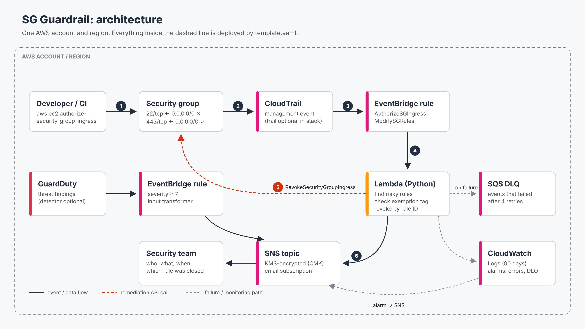

# SG Guardrail

Automatically revokes security group rules that open sensitive ports (SSH, RDP, databases, or all traffic) to `0.0.0.0/0` or `::/0`, sends an alert naming who made the change, and emails you about high-severity GuardDuty findings.



## Deploy

```bash
sam build
sam deploy --guided --stack-name sg-guardrail --capabilities CAPABILITY_IAM
```

| Parameter | Default | Notes |
|---|---|---|
| `AlertEmail` | (required) | Confirm the SNS subscription email after deploying |
| `SensitivePorts` | `22,3389,3306,5432,1433,6379,9200,27017` | Ports that must never be world-open |
| `DryRun` | `false` | `true` = alert only |
| `CreateTrail` | `false` | `true` if the account/region has no CloudTrail trail |
| `EnableGuardDuty` | `false` | `true` only if GuardDuty is not already on in this region |

## Test

```bash
python -m pip install pytest boto3 && python -m pytest -q   # unit tests, no AWS needed
./scripts/test-open-ssh.sh                                  # end-to-end in your account
aws guardduty create-sample-findings --detector-id <id> --finding-types Backdoor:EC2/C&CActivity.B
```

## Exceptions

Tag a group `SecurityException=approved` to skip it. Protect that tag with `policies/scp-protect-exception-tag.json`.

## Clean up

```bash
./scripts/cleanup.sh
```

## Layout

```
template.yaml                 AWS SAM template (all infrastructure)
src/remediate.py              Lambda function
tests/test_remediate.py       Unit tests (15)
scripts/test-open-ssh.sh      End-to-end test with timing
scripts/cleanup.sh            Tear-down
policies/                     SCP that protects the exemption tag
article/                      Blog post + images
```
