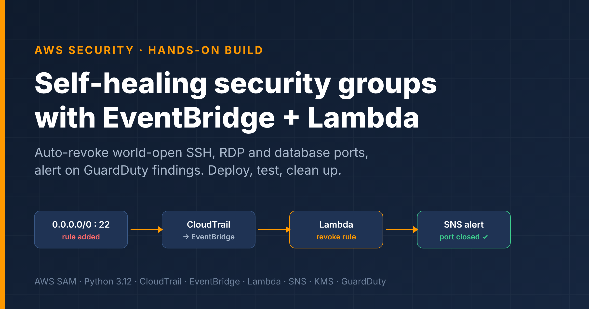
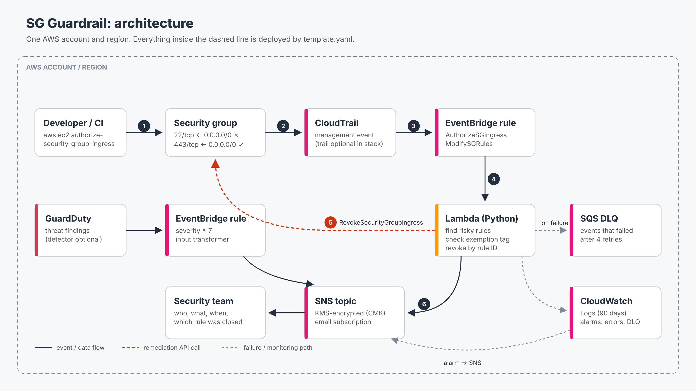
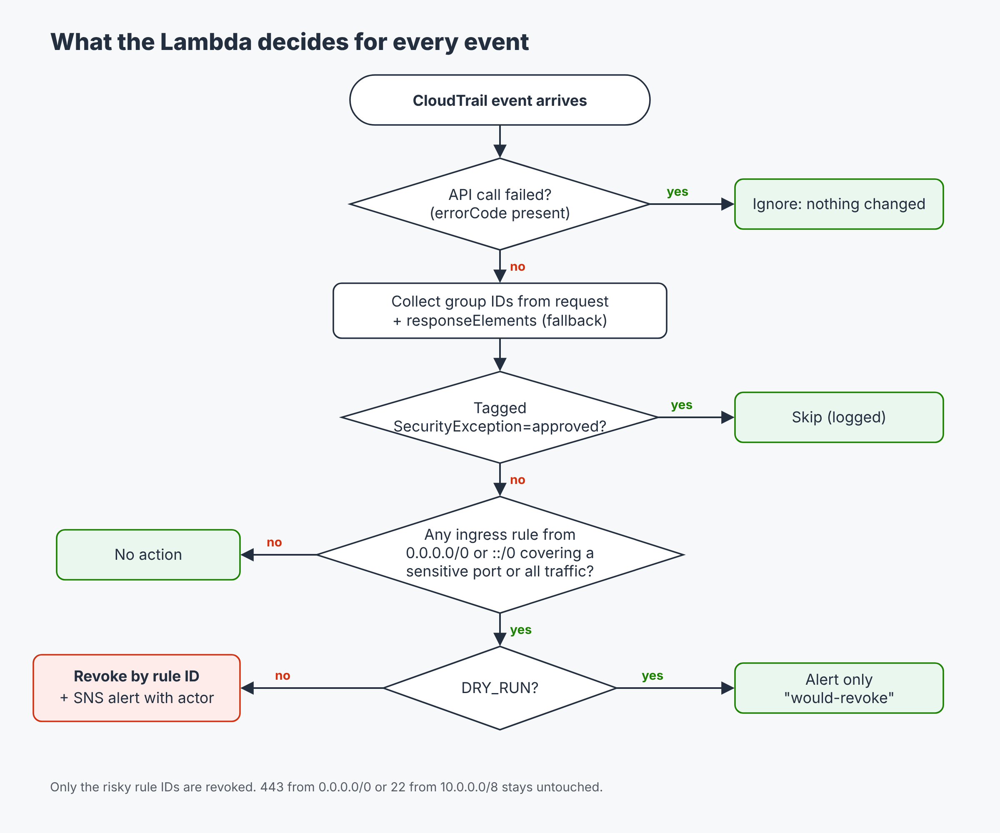

<!--
  BEFORE YOU PUBLISH: search this file for "✏️" and replace each marker
  with your own result from deploying (timings, screenshots, what surprised you).
  The Ear rewards real experience; those spots are where yours goes.
-->



# Self-Healing Security Groups: Auto-Revoke World-Open SSH and RDP with EventBridge, Lambda and SAM

**TL;DR:** Someone runs `authorize-security-group-ingress --port 22 --cidr 0.0.0.0/0`. A few seconds later the rule is gone, the 443 rule next to it is untouched, and your security team gets an email saying who did it, from which IP, and which rule was closed. High-severity GuardDuty findings land in the same inbox. Everything is one AWS SAM template you can deploy, test and delete in about 15 minutes.

📦 **Repo:** ✏️ `https://github.com/<you>/aws-sg-guardrail`
⏱️ **Time:** ~15 minutes · 💰 **Cost:** about $1–2/month outside GuardDuty (breakdown below)

---

## The problem

Every AWS account I have reviewed has had at least one security group with port 22 or 3389 open to `0.0.0.0/0`. It's almost never malicious. Someone is debugging at 11 p.m., opens SSH "just for a minute", and forgets. Internet-wide scanners find an open SSH port within minutes, not days.

Detection-only tools such as AWS Config rules and Security Hub controls tell you about it. Then a human has to see the finding, triage it and fix it. I wanted the fix to happen automatically, in seconds, and only for rules that are clearly wrong, so the guardrail never becomes the thing people complain about.

## What you'll build



1. A person or pipeline adds an ingress rule.
2. CloudTrail records the `AuthorizeSecurityGroupIngress` (or `ModifySecurityGroupRules`) API call.
3. An **EventBridge** rule matches that event.
4. A **Lambda** function reads the group's current rules.
5. It revokes **only** the rules that are world-open on a sensitive port.
6. It publishes a KMS-encrypted **SNS** alert with the actor, source IP and rule details.

On the side, a second EventBridge rule sends **GuardDuty** findings with severity ≥ 7 to the same topic. An **SQS dead-letter queue** and two **CloudWatch alarms** make sure the guardrail can't fail silently.

## Why this design, and not the alternatives

I considered four approaches before writing any code:

| Option | Speed | Why I didn't pick it (or did) |
|---|---|---|
| **AWS Config rule + SSM remediation** (`restricted-ssh`) | Minutes (evaluation delay) | Good for compliance reporting, but slower, and the managed remediation document removes rules more broadly than I wanted. |
| **AWS Firewall Manager** SG audit policy | Minutes | Excellent at org scale, but needs AWS Organizations plus a Firewall Manager admin, and has a per-policy cost. Overkill for one team. |
| **SCP that denies the API call** | Prevents it | SCPs can't inspect the CIDR or port inside `ipPermissions`, so you can't deny only `0.0.0.0/0:22`. |
| **EventBridge + Lambda** ✅ | Seconds | Precise (rule-level), cheap, easy to read, and the same code works in one account or across an org. |

The tradeoff is clear: this is **detect-and-correct, not prevent**. For a short window (seconds) the rule does exist. If that window is unacceptable for you, put the account behind Firewall Manager or a network firewall as well. This guardrail is a layer, not the whole defence.

## Prerequisites

- An AWS account where you can create IAM roles (use a sandbox account first)
- [AWS SAM CLI](https://docs.aws.amazon.com/serverless-application-model/latest/developerguide/install-sam-cli.html) and AWS CLI v2, configured
- Python 3.12 (for local tests)
- A CloudTrail trail in the region. If you don't have one, the template can create it (`CreateTrail=true`). An Organizations or Control Tower trail already counts.

## Step 1: Get the project

```bash
git clone https://github.com/<you>/aws-sg-guardrail.git   # ✏️ your repo URL
cd aws-sg-guardrail
```

```
template.yaml               all infrastructure (SAM)
src/remediate.py           the Lambda function
tests/test_remediate.py    15 unit tests, no AWS needed
scripts/test-open-ssh.sh   end-to-end test with timing
scripts/cleanup.sh         tear-down
policies/                  SCP that protects the exemption tag
```

## Step 2: Understand the decision logic

Before the code, here's what the function decides for every event:



Three choices matter here.

**1. Re-read the group, don't trust the event payload.** The `ipPermissions` structure in CloudTrail differs between `AuthorizeSecurityGroupIngress` and `ModifySecurityGroupRules`, and between calls made by group ID and by group name. Instead of parsing all of those shapes, the function pulls out the group ID and asks EC2 for the group's **current** rules. This also makes the function idempotent: if an event is delivered twice, the second run finds nothing to revoke.

**2. Revoke by rule ID.** `RevokeSecurityGroupIngress` accepts `SecurityGroupRuleIds`. Revoking by ID removes exactly the bad rule. Rebuilding an `IpPermissions` block risks removing a neighbouring rule that shares the same port.

**3. Treat "all traffic" and port ranges as sensitive.** `IpProtocol: -1` and `FromPort 0 – ToPort 65535` both include port 22, even though neither "is" SSH.

## Step 3: The Lambda function

Here are the core parts of `src/remediate.py`. The full file is in the repo.

**Finding the group ID, wherever CloudTrail put it:**

```python
def group_ids_from_event(detail: dict) -> set:
    ids = set()
    params = detail.get("requestParameters") or {}
    if params.get("groupId"):
        ids.add(params["groupId"])

    modify = params.get("ModifySecurityGroupRulesRequest") or {}
    if modify.get("GroupId"):
        ids.add(modify["GroupId"])

    # Fallback: calls made by group *name* (default VPC) have no groupId,
    # but the response lists the rules that were created.
    response = detail.get("responseElements") or {}
    for item in (response.get("securityGroupRuleSet") or {}).get("items") or []:
        if item.get("groupId"):
            ids.add(item["groupId"])
    return ids
```

**Deciding whether a rule is risky:**

```python
OPEN_CIDRS = {"0.0.0.0/0", "::/0"}

def covers_sensitive_port(rule: dict) -> bool:
    protocol = str(rule.get("IpProtocol"))
    if protocol == "-1":                       # "All traffic"
        return True
    if protocol not in ("tcp", "udp", "6", "17"):
        return False                           # ICMP is out of scope
    low, high = rule.get("FromPort"), rule.get("ToPort")
    if low is None or high is None or low == -1:
        return True
    return any(low <= port <= high for port in SENSITIVE_PORTS)

def is_risky(rule: dict) -> bool:
    return (not rule.get("IsEgress", False)
            and (rule.get("CidrIpv4") in OPEN_CIDRS or rule.get("CidrIpv6") in OPEN_CIDRS)
            and covers_sensitive_port(rule))
```

**Remediating:**

```python
def remediate_group(group_id: str, detail: dict) -> dict:
    actor = (detail.get("userIdentity") or {}).get("arn", "unknown")

    if is_exempt(group_id):                    # tag SecurityException=approved
        return {"groupId": group_id, "action": "exempt"}

    risky = find_risky_rules(group_id)         # paginated DescribeSecurityGroupRules
    if not risky:
        return {"groupId": group_id, "action": "none"}

    rule_ids = [r["SecurityGroupRuleId"] for r in risky]
    if DRY_RUN:
        action = "would-revoke"
    else:
        ec2.revoke_security_group_ingress(GroupId=group_id, SecurityGroupRuleIds=rule_ids)
        action = "revoked"

    notify(f"[SG Guardrail] {action} {len(rule_ids)} rule(s) on {group_id}", {
        "action": action, "groupId": group_id, "changedBy": actor,
        "sourceIp": detail.get("sourceIPAddress"),
        "rules": [describe_rule(r) for r in risky],
    })
    return {"groupId": group_id, "action": action, "rules": rule_ids}
```

**The handler** skips failed API calls (`errorCode` present means nothing was created) and treats an already-deleted group as success. Any other error is re-raised on purpose, so EventBridge retries and, if retries run out, the event lands in the DLQ instead of disappearing.

```python
def handler(event, context):
    detail = event.get("detail") or {}
    if detail.get("errorCode"):
        return {"results": []}

    results = []
    for group_id in sorted(group_ids_from_event(detail)):
        try:
            results.append(remediate_group(group_id, detail))
        except ClientError as err:
            if err.response["Error"]["Code"] in ("InvalidGroup.NotFound",
                                                 "InvalidSecurityGroupRuleId.NotFound"):
                results.append({"groupId": group_id, "action": "gone"})
            else:
                raise
    return {"results": results}
```

> **Will it trigger itself?** No. The function calls `RevokeSecurityGroupIngress`, and the EventBridge rule only matches `AuthorizeSecurityGroupIngress` and `ModifySecurityGroupRules`. No loop.

## Step 4: The infrastructure (SAM)

The highlights of `template.yaml`:

**The event pattern:**

```yaml
Events:
  SecurityGroupChanged:
    Type: EventBridgeRule
    Properties:
      Pattern:
        source: [aws.ec2]
        detail-type: [AWS API Call via CloudTrail]
        detail:
          eventSource: [ec2.amazonaws.com]
          eventName: [AuthorizeSecurityGroupIngress, ModifySecurityGroupRules]
      RetryPolicy:
        MaximumRetryAttempts: 4
        MaximumEventAgeInSeconds: 900
      DeadLetterConfig:
        Arn: !GetAtt RemediationDLQ.Arn
```

**Least-privilege IAM.** The function can *close* rules but never *open* them. The `Describe*` actions don't support resource-level permissions, so they need `"*"`. Everything else is scoped:

```yaml
Policies:
  - Version: "2012-10-17"
    Statement:
      - Sid: ReadSecurityGroups
        Effect: Allow
        Action: [ec2:DescribeSecurityGroups, ec2:DescribeSecurityGroupRules]
        Resource: "*"
      - Sid: RevokeOnly
        Effect: Allow
        Action: ec2:RevokeSecurityGroupIngress
        Resource: !Sub "arn:${AWS::Partition}:ec2:${AWS::Region}:${AWS::AccountId}:security-group/*"
      - Sid: Alert
        Effect: Allow
        Action: sns:Publish
        Resource: !Ref AlertTopic
```

**GuardDuty, severity ≥ 7, as a readable email.** Content-based numeric filtering keeps low-severity noise out:

```yaml
GuardDutyHighSeverityRule:
  Type: AWS::Events::Rule
  Properties:
    EventPattern:
      source: [aws.guardduty]
      detail-type: [GuardDuty Finding]
      detail:
        severity: [{ numeric: [">=", 7] }]
    Targets:
      - Id: alert-topic
        Arn: !Ref AlertTopic
        InputTransformer:
          InputPathsMap: { type: $.detail.type, severity: $.detail.severity, region: $.region, title: $.detail.title }
          InputTemplate: |
            "GuardDuty HIGH finding <type> (severity <severity>) in <region>."
            "<title>"
```

**Don't fail silently.** There are two alarms, on Lambda `Errors` and on DLQ depth, both of which notify the same SNS topic. A security control that breaks quietly is worse than no control, because everyone assumes it's working.

## Step 5: Test locally first

The unit tests mock EC2 and SNS, so they need no AWS credentials. They cover SSH, RDP, port ranges, "all traffic", IPv6 `::/0`, private CIDRs, egress, ICMP, exemption tags, dry-run, failed API calls and deleted groups.

```bash
python -m pip install pytest boto3
python -m pytest -q
```

```
...............                                                          [100%]
15 passed in 0.33s
```

## Step 6: Deploy

```bash
sam validate --lint
sam build
sam deploy --guided --stack-name sg-guardrail --capabilities CAPABILITY_IAM
```

Answer the prompts: your `AlertEmail`, then `CreateTrail=true` only if the region has no trail, and `EnableGuardDuty=true` only if GuardDuty is off (a region allows just one detector, so the deploy fails if one exists).

> 💡 **Tip for shared accounts:** deploy with `DryRun=true` for the first week. You'll get "would-revoke" emails and find out which teams rely on world-open rules *before* you break them.

**Then confirm the SNS subscription** from the email AWS sends you. Until you click the link, alerts go nowhere. That is the most common reason for "it revoked the rule but I got no email".


## Step 7: Verify end-to-end

The test script creates a throwaway security group in your default VPC, opens **22 and 443** to the world, then polls until port 22 disappears. Port 443 must survive. That proves the function is precise, not just aggressive.

```bash
./scripts/test-open-ssh.sh
```

Expected output:

```
Created sg-0a1b2c3d4e5f in vpc-0123 (us-east-1)
Opened 22/tcp and 443/tcp to 0.0.0.0/0 - waiting for the guardrail...
PASS: port 22 rule revoked 
Remaining ingress rule: 443  0.0.0.0/0
Deleted sg-0a1b2c3d4e5f
```


Check the logs:

```bash
sam logs --stack-name sg-guardrail --name RemediationFunction --tail
```

**Test the GuardDuty path** with a sample finding (sample findings don't touch your resources):

```bash
DETECTOR=$(aws guardduty list-detectors --query 'DetectorIds[0]' --output text)
aws guardduty create-sample-findings --detector-id "$DETECTOR" \
  --finding-types "Backdoor:EC2/C&CActivity.B"
```

**Test the exemption:**

```bash
aws ec2 create-tags --resources <sg-id> --tags Key=SecurityException,Value=approved
```

Rules on that group are now logged and skipped.

## What tripped me up (so it doesn't trip you)


**1. SNS encryption can silently break the GuardDuty alerts.** The obvious choice is to encrypt the topic with the AWS-managed key `alias/aws/sns`. Lambda can still publish with it, but EventBridge can't, so the GuardDuty path delivers nothing and nothing reports an error. The AWS-managed key's policy can't be edited to let `events.amazonaws.com` use it. **Fix:** a customer-managed KMS key whose key policy allows EventBridge `kms:GenerateDataKey*` and `kms:Decrypt`. It costs $1/month and it's in the template.

**2. The SAM DLQ syntax.** I wrote `DeadLetterConfig: { Type: SQS, Destination: ... }`, and `cfn-lint` rejected it. For an existing queue, SAM wants `Arn:`. You must also add an `AWS::SQS::QueuePolicy` that lets `events.amazonaws.com` call `sqs:SendMessage`, or failed events are dropped. Run `sam validate --lint` before every deploy.

**3. Calls by group name have no `groupId`.** In a default VPC, `--group-name web` works, and then `requestParameters.groupId` is empty. Reading `responseElements.securityGroupRuleSet` covers that case.

**4. Fighting your own IaC.** If a Terraform or CloudFormation stack *declares* `0.0.0.0/0:22`, the guardrail revokes the rule and the next apply re-creates it, in an endless loop. That is the guardrail working as designed. Fix the IaC, or apply an approved exception.

**5. The exemption tag is a privilege-escalation path.** If anyone can tag a group `SecurityException=approved`, the guardrail is optional. Protect the tag with an SCP (`policies/scp-protect-exception-tag.json`):

```json
{
  "Version": "2012-10-17",
  "Statement": [{
    "Sid": "OnlySecurityAdminsCanGrantSGExceptions",
    "Effect": "Deny",
    "Action": ["ec2:CreateTags", "ec2:DeleteTags"],
    "Resource": "arn:aws:ec2:*:*:security-group/*",
    "Condition": {
      "ForAnyValue:StringEquals": { "aws:TagKeys": ["SecurityException"] },
      "ArnNotLike": { "aws:PrincipalArn": "arn:aws:iam::*:role/SecurityAdmin" }
    }
  }]
}
```

## Production thinking

**Scale: multiple regions and accounts.** Security groups are regional, and so are EventBridge rules. Deploy the stack in **every region you use** (or every enabled region, because attackers love unused ones) with CloudFormation StackSets across your organization:

```bash
aws cloudformation create-stack-set --stack-set-name sg-guardrail \
  --template-body file://.aws-sam/build/packaged.yaml \
  --permission-model SERVICE_MANAGED \
  --auto-deployment Enabled=true,RetainStacksOnAccountRemoval=false \
  --capabilities CAPABILITY_IAM \
  --parameters ParameterKey=AlertEmail,ParameterValue=secops@example.com
```

(First run `sam package --output-template-file .aws-sam/build/packaged.yaml --s3-bucket <bucket>` so the Lambda code is in S3.)

**Security.** The function can only revoke, never authorize. Alerts are encrypted with a CMK that has rotation on. Logs are kept for 90 days. The trail bucket (if created) blocks public access, enforces TLS and has log-file validation turned on.

**What it does *not* cover (be honest with your auditors):**

- Rules that already existed before you deployed. Run a one-off sweep, or use the AWS Config `restricted-ssh` / `vpc-sg-open-only-to-authorized-ports` rules for posture reporting.
- Rules that reference prefix lists or other security groups (by design these aren't "the internet").
- The short window between creation and revocation. CloudTrail-to-EventBridge delivery is best-effort and usually fast, but it isn't instant.
- Network ACLs and load balancers in front of an instance.

**Cost** (us-east-1, list prices; check the pricing pages for your region):

| Item | Approx. monthly |
|---|---|
| Lambda, a few hundred invocations | $0.00 (free tier) |
| EventBridge, AWS service events | $0.00 |
| SNS email | $0.00 (first 1,000 emails free) |
| KMS customer-managed key | $1.00 |
| CloudWatch alarms ×2 | $0.20 |
| SQS DLQ | ~$0.00 |
| CloudTrail, first copy of management events | $0.00 + S3 storage |
| GuardDuty | 30-day free trial, then usage-based. The biggest line item by far. |

## Clean up

```bash
./scripts/cleanup.sh
```

The script empties the trail bucket (if the stack created one), then runs `sam delete`. The KMS key enters its standard pending-deletion period, which is expected. If you enabled GuardDuty only for this tutorial, disable it in the console, or remove it by redeploying with `EnableGuardDuty=false` before deleting the stack.

**Tags:** `#security` `#eventbridge` `#lambda` `#aws-sam` `#guardduty` `#automation`
